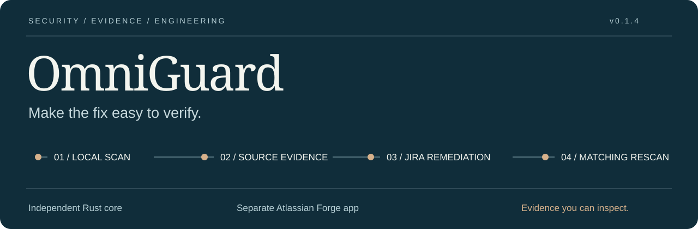
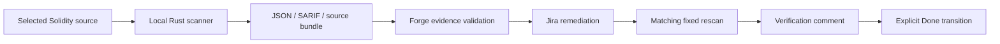

<p align="center"></p>

<p align="center">
  <a href="docs/judge-guide.md"><strong>Try it in Jira</strong></a> ·
  <a href="#run-a-local-scan"><strong>Run a scan</strong></a> ·
  <a href="docs/rules.md"><strong>Explore the rules</strong></a> ·
  <a href="docs/architecture.md"><strong>Read the architecture</strong></a>
</p>

[](https://github.com/Protocol-X-01/OmniGuard/actions/workflows/ci.yml)
[MIT licensed](LICENSE) · Rust 1.93 · Engine 0.1.4 · Early access

**OmniGuard connects a security finding to the source that supports it, a real Jira remediation, and a matching rescan.**

The independent Rust core analyzes Solidity syntax and optional native compiler facts. The separate Atlassian Forge app brings those results into the review workflow: inspect the evidence, create a task, check the changed source, and record what was verified.

## Follow the evidence



| A useful finding needs… | OmniGuard provides |
| --- | --- |
| A source you can identify | SHA-256 snapshots, exact excerpts, byte spans and related locations |
| Context beyond one statement | Bounded compiler bindings across direct helpers, storage aliases and selected modifiers |
| A review baseline that survives handoff | Engine, rules, analysis mode and compiler version retained with the Jira issue |
| A fix checked under the same conditions | Weaker, incomplete or mismatched rescans cannot verify the baseline |

<details open>
<summary><strong>Real production Jira acceptance — KAN-6</strong></summary>


The vulnerable fixture produced one finding. A source-only zero-finding rescan was rejected; the matching compiler rescan recorded comment **10005**. The fixed report and **Done** status survived reload. [Inspect the acceptance record](docs/acceptance-production-cs0lutions-2026-11-14.md).

</details>

## Try the Jira workflow

[**Install OmniGuard for Jira**](https://developer.atlassian.com/console/install/2dcc2164-b65e-43a5-90c8-bc4ac20447ab?signature=AYABeC71pFlRaXSdKnl2xdp%2B0EMAAAADAAdhd3Mta21zAEthcm46YXdzOmttczp1cy13ZXN0LTI6NzA5NTg3ODM1MjQzOmtleS83MDVlZDY3MC1mNTdjLTQxYjUtOWY5Yi1lM2YyZGNjMTQ2ZTcAuAECAQB4CxqLTo9l4lqXuFjNim1xJM%2Bp%2F3TVP9xHS2BrU5DRRucBzaUP%2FSt0sw0lgROi4h60WQAAAH4wfAYJKoZIhvcNAQcGoG8wbQIBADBoBgkqhkiG9w0BBwEwHgYJYIZIAWUDBAEuMBEEDFeXZWYPl8paRudO%2BQIBEIA7foYy2q3M8lVTV7Wp3rPQStyG1Siy6Z8qJ6r3TXWm%2FcjvFfJpbfx8ncv1RMv7hkmYwWbl6oFLmeenz2MAB2F3cy1rbXMAS2Fybjphd3M6a21zOmV1LXdlc3QtMTo3MDk1ODc4MzUyNDM6a2V5LzQ2MzBjZTZiLTAwYzMtNGRlMi04NzdiLTYyN2UyMDYwZTVjYwC4AQICAHi9bVMAkme4qVQX1fQHo6ePw3H40A7cGfz7yrmSfBWMXgEQGXV7ZDI18eyfZhxgodPCAAAAfjB8BgkqhkiG9w0BBwagbzBtAgEAMGgGCSqGSIb3DQEHATAeBglghkgBZQMEAS4wEQQMEz304naJVPS2fn1zAgEQgDsIj%2BCbI6UtLY4elLQRCVzlGNNUwHLnhSascslz3flwpA4X2dvPrPoVzFIC8XJ4nZPpo1nwZ%2BG3bpl8lAAHYXdzLWttcwBLYXJuOmF3czprbXM6dXMtZWFzdC0xOjcwOTU4NzgzNTI0MzprZXkvNmMxMjBiYTAtNGNkNS00OTg1LWI4MmUtNDBhMDQ5NTJjYzU3ALgBAgIAeDYASx0XCjkny4iLV6vz%2BKtEGSGT6kdt0QRpkn6D%2FlVEAZB%2BuV2QD6CG48m409My6XkAAAB%2BMHwGCSqGSIb3DQEHBqBvMG0CAQAwaAYJKoZIhvcNAQcBMB4GCWCGSAFlAwQBLjARBAyCJA%2BBJyiExLMJz1oCARCAOyXZ5hF%2FK7jYfa6kqZZbX%2FJ31gnduu68YBfqxKYolyjWa63c5f0L%2BcwNbdDDFVqs04gZ2r9F1VkFQrPiAgAAAAAMAAAQAAAAAAAAAAAAAAAAAHTQsM73DKpHpSqe89saxDn%2F%2F%2F%2F%2FAAAAAQAAAAAAAAAAAAAAAQAAADL6YguqMOqPZnHgoKT9e4mfmeK2Y%2FF1c9MTgWafQjRPe1Oj0bZa3vrDtH8rAWFwStBEvIenvwgTo1evSRY4nKpsWuA%3D&product=jira) · [Privacy policy](https://cs0lutions.atlassian.net/wiki/external/YWQ1ZWRkNDFiMzVlNGZkY2JlZmJkOGY5MTNhNzYzNGI) · [Step-by-step judge guide](docs/judge-guide.md)

A Jira site administrator installs the app. The supplied [three-report fixture set](reports/judge/) needs no local compiler or wallet. It includes the intentional weaker-rescan check. Project users need permission to create Tasks, add comments and use a completion transition.

The app imports full selected fixture source and retains scan/history records and importer attribution. See the privacy notice before importing. Production **2.0.0** is accepted on cs0lutions; a separate judge-site installation is still untested.

## Run a local scan

Source mode needs Rust and a C build toolchain. The repository pins Rust **1.93.0**; it needs no Node, Atlassian account or chain connection.

```sh
git clone https://github.com/Protocol-X-01/OmniGuard.git
cd OmniGuard
cargo build --locked --release --workspace
./target/release/omniguard scan fixtures/patterns/vulnerable
./target/release/omniguard scan fixtures/patterns/fixed --format json
./target/release/omniguard scan fixtures/patterns/vulnerable --format sarif --output omniguard.sarif
```

For compiler-resolved analysis, supply your own native solc 0.8.26:

```sh
./target/release/omniguard scan fixtures/effect-vault/vulnerable --solc /path/to/solc
```

Foundry projects use their configured source directory. `--fail-on high` returns exit 1 for a matching finding; incomplete/error input returns 2. A completed scan without a threshold returns 0 even when it contains findings. [Full CLI and reproduction guide](docs/cli-and-analysis.md).

## What is measured

| Check | Recorded result | Evidence |
| --- | --- | --- |
| Rust core and compiler tests | 38 passed | [Native-effect validation](reports/benchmarks/native-effects/validation.json) |
| Forge service tests | 23 passed | [Remediation tests](integrations/atlassian-forge/test/) |
| Local effect-vault execution | 3 witnesses, including a 128-run paired fuzz property | [Execution record](docs/native-effects.md) |
| Frozen synthetic review | 24/26 labels matched; 6 reports incomplete | [Review methodology and limits](fixtures/effect-review/README.md) |
| Interface review | Keyboard, contrast, reflow and failed-rescan recovery checked | [Accessibility evidence](docs/accessibility.md) |

These are fixture measurements, not production precision or recall. **Explicit-super dispatch and one composed-modifier evidence-budget case remain incomplete.** Twelve rule classes do not cover every vulnerability. Source consistency is not proof of exploitability or a signed attestation that the scanner ran.

## Explore the project

| Component | Purpose |
| --- | --- |
| [Rust core](crates/omniguard-core/) / [CLI](crates/omniguard-cli/) | Deterministic AST analysis, optional compiler facts and evidence validation |
| [Contracts](contracts/) | Versioned report and source-bundle schemas |
| [Fixtures](fixtures/) / [Reports](reports/) | Positive/fixed/negative cases and dated measurements |
| [Forge Jira](integrations/atlassian-forge/) | Report import, evidence ledger and real remediation workflow |
| [Local dashboard](dashboard/) | Accessible loopback fixture demo with explicitly local drafts |
| [Bitbucket scaffold](integrations/atlassian-bitbucket/) | Separate integration starting point; live PR scanning is unfinished |
| [Technical spec](SPEC.md) / [Release guide](docs/release.md) | Scope, boundaries, reproducibility and deployment |

The core and Forge remain separate: neither imports the other's runtime. No OmniScan or MULTI-CHAIN-FRAMEWORK code, dataset or runtime was copied into this project. The wider multi-chain research is separate work.

## Build with us

Start with [CONTRIBUTING.md](CONTRIBUTING.md), bring an isolated regression and a matching fix, and keep unsupported cases visible. [Report a security issue privately](SECURITY.md), browse the [changelog](CHANGELOG.md), or contact **protocolx76@gmail.com**.

Codegeist target: **Apps for Software Teams**. Public YouTube publication, independent judge-site acceptance and final submission remain open. See [the submission guide](docs/judge-guide.md) for the current status.
