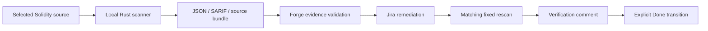
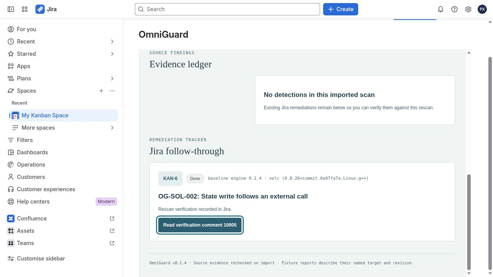
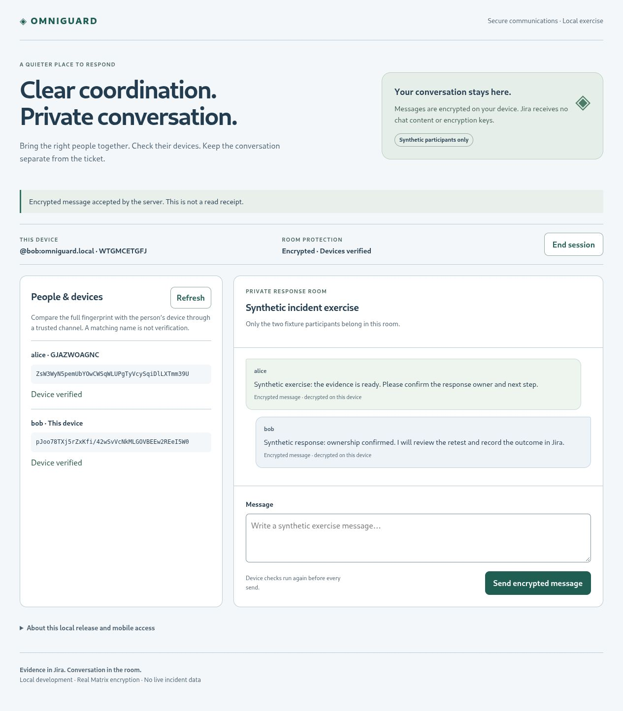

<p align="center"></p>

<p align="center">
  <a href="https://omniguard-n5h9.onrender.com/"><strong>Project site</strong></a> ·
  <a href="https://www.youtube.com/watch?v=eTlsw__RC_o"><strong>Watch the demo</strong></a> ·
  <a href="https://devpost.com/software/omniguard-z1pmcg"><strong>Codegeist entry</strong></a> ·
  <a href="docs/judge-guide.md"><strong>Try it in Jira</strong></a> ·
  <a href="#run-a-local-scan"><strong>Run a scan</strong></a> ·
  <a href="docs/rules.md"><strong>Explore the rules</strong></a> ·
  <a href="docs/architecture.md"><strong>Read the architecture</strong></a>
</p>

[](https://github.com/Protocol-X-01/OmniGuard/actions/workflows/ci.yml)
[MIT licensed](LICENSE) · Rust 1.93 · Engine 0.1.4 · Early access

**OmniGuard connects a security finding to the source that supports it, a real Jira remediation, and a matching rescan.**

The independent Rust core analyzes Solidity syntax and optional native compiler facts. The separate Atlassian Forge app brings those results into the review workflow: inspect the evidence, create a task, check the changed source, and record what was verified.

<!-- project-status:start -->
## Current availability

Updated **2026-11-17**. These are dated acceptance records, not continuous monitoring of hosted services. Source publication does not promote development or local features to production.

| Capability | Dated evidence | Boundary |
| --- | --- | --- |
| Source evidence → Jira → matching rescan | [Production acceptance · 2026-11-14](https://github.com/Protocol-X-01/OmniGuard/blob/main/docs/acceptance-production-cs0lutions-2026-11-14.md) | Static findings and supplied evidence consistency do not certify safety or scanner execution. |
| Bitbucket PR scans and Jira provenance | [Production acceptance · 2026-11-14](https://github.com/Protocol-X-01/OmniGuard/blob/main/docs/acceptance-bitbucket-2026-11-14.md) | Public isolated fixtures only. Import, verification and completion remain reviewer actions; no private/fork PR support or execution attestation. |
| Team defence and reviewed owner contact | [Forge development acceptance · 2026-11-14](https://github.com/Protocol-X-01/OmniGuard/blob/main/docs/acceptance-frontline-cs0lutions-dev-2026-11-14.md) | Acceptance was development 3.6.0; a self-mention is not an independent reviewer test, online presence or a read receipt. |
| Shared review queue and explicit handoffs | [Forge development preview · 2026-11-17](https://github.com/Protocol-X-01/OmniGuard/blob/main/docs/acceptance-review-queue-2026-11-17.md) | One real Jira actor tested. Independent two-user Jira acceptance and production promotion remain pending; reviews do not complete issues or certify safety. |
| Encrypted conversation and file/folder handoff | [Local browser acceptance · 2026-11-17](https://github.com/Protocol-X-01/OmniGuard/blob/main/docs/evidence/transfers-2026-11-17/transfer-browser-acceptance.json) | Loopback lab only: 100 files / 10 MiB. No production identity, hosting, recovery, retention or physical mobile acceptance. Integrity is not malware scanning. |
| Combined defence regression lab | [Local fixture acceptance · 2026-11-16](https://github.com/Protocol-X-01/OmniGuard/blob/main/fixtures/combined-defence/README.md) | Ten demonstrated properties remain undetected. The strict all-case gate fails as expected. Authored fixtures do not measure general accuracy. |

[Next priorities and release checklist](docs/project-status.md)
<!-- project-status:end -->

[Shared review queue: use it, run the local exercise and deploy development](docs/shared-review-queue.md).

## Follow the evidence



| A useful finding needs… | OmniGuard provides |
| --- | --- |
| A source you can identify | SHA-256 snapshots, exact excerpts, byte spans and related locations |
| Context beyond one statement | Bounded compiler bindings across direct helpers, storage aliases and selected modifiers |
| A review baseline that survives handoff | Engine, rules, analysis mode and compiler version retained with the Jira issue |
| A fix checked under the same conditions | Weaker, incomplete or mismatched rescans cannot verify the baseline |

<details open>
<summary><strong>Real production Jira acceptance — KAN-6</strong></summary>



The vulnerable fixture produced one finding. A source-only zero-finding rescan was rejected; the matching compiler rescan recorded comment **10005**. The fixed report and **Done** status survived reload. [Inspect the acceptance record](docs/acceptance-production-cs0lutions-2026-11-14.md).

</details>

## Try the Jira workflow

[**Install OmniGuard for Jira**](https://developer.atlassian.com/console/install/2dcc2164-b65e-43a5-90c8-bc4ac20447ab?signature=AYABeC71pFlRaXSdKnl2xdp%2B0EMAAAADAAdhd3Mta21zAEthcm46YXdzOmttczp1cy13ZXN0LTI6NzA5NTg3ODM1MjQzOmtleS83MDVlZDY3MC1mNTdjLTQxYjUtOWY5Yi1lM2YyZGNjMTQ2ZTcAuAECAQB4CxqLTo9l4lqXuFjNim1xJM%2Bp%2F3TVP9xHS2BrU5DRRucBzaUP%2FSt0sw0lgROi4h60WQAAAH4wfAYJKoZIhvcNAQcGoG8wbQIBADBoBgkqhkiG9w0BBwEwHgYJYIZIAWUDBAEuMBEEDFeXZWYPl8paRudO%2BQIBEIA7foYy2q3M8lVTV7Wp3rPQStyG1Siy6Z8qJ6r3TXWm%2FcjvFfJpbfx8ncv1RMv7hkmYwWbl6oFLmeenz2MAB2F3cy1rbXMAS2Fybjphd3M6a21zOmV1LXdlc3QtMTo3MDk1ODc4MzUyNDM6a2V5LzQ2MzBjZTZiLTAwYzMtNGRlMi04NzdiLTYyN2UyMDYwZTVjYwC4AQICAHi9bVMAkme4qVQX1fQHo6ePw3H40A7cGfz7yrmSfBWMXgEQGXV7ZDI18eyfZhxgodPCAAAAfjB8BgkqhkiG9w0BBwagbzBtAgEAMGgGCSqGSIb3DQEHATAeBglghkgBZQMEAS4wEQQMEz304naJVPS2fn1zAgEQgDsIj%2BCbI6UtLY4elLQRCVzlGNNUwHLnhSascslz3flwpA4X2dvPrPoVzFIC8XJ4nZPpo1nwZ%2BG3bpl8lAAHYXdzLWttcwBLYXJuOmF3czprbXM6dXMtZWFzdC0xOjcwOTU4NzgzNTI0MzprZXkvNmMxMjBiYTAtNGNkNS00OTg1LWI4MmUtNDBhMDQ5NTJjYzU3ALgBAgIAeDYASx0XCjkny4iLV6vz%2BKtEGSGT6kdt0QRpkn6D%2FlVEAZB%2BuV2QD6CG48m409My6XkAAAB%2BMHwGCSqGSIb3DQEHBqBvMG0CAQAwaAYJKoZIhvcNAQcBMB4GCWCGSAFlAwQBLjARBAyCJA%2BBJyiExLMJz1oCARCAOyXZ5hF%2FK7jYfa6kqZZbX%2FJ31gnduu68YBfqxKYolyjWa63c5f0L%2BcwNbdDDFVqs04gZ2r9F1VkFQrPiAgAAAAAMAAAQAAAAAAAAAAAAAAAAAHTQsM73DKpHpSqe89saxDn%2F%2F%2F%2F%2FAAAAAQAAAAAAAAAAAAAAAQAAADL6YguqMOqPZnHgoKT9e4mfmeK2Y%2FF1c9MTgWafQjRPe1Oj0bZa3vrDtH8rAWFwStBEvIenvwgTo1evSRY4nKpsWuA%3D&product=jira) · [Privacy policy](https://cs0lutions.atlassian.net/wiki/external/YWQ1ZWRkNDFiMzVlNGZkY2JlZmJkOGY5MTNhNzYzNGI) · [Step-by-step judge guide](docs/judge-guide.md) · [Download the fixture pack](https://github.com/Protocol-X-01/OmniGuard/releases/download/v0.1.4/omniguard-0.1.4-judge-fixtures.zip)

A Jira site administrator installs the app. The supplied [three-report fixture set](reports/judge/) needs no local compiler or wallet. It includes the intentional weaker-rescan check. Project users need permission to create Tasks, add comments and use a completion transition.

The app imports full selected fixture source and retains scan/history records. New imports do not store importer account IDs; project administrators can remove that field from older scans. See the privacy notice before importing. Jira production **3.0.0** is installed on cs0lutions; the [separate temporary Jira site](docs/acceptance-separate-site-2026-11-14.md) remains on **2.1.0**. Both sites are administered by the same owner. The [privacy rollout record](docs/privacy-minimization.md) confirms cleanup and retained Jira evidence after reload.

## Review a Bitbucket pull request

The separate Bitbucket app is installed in the **omniguard** workspace. [Fixture PR #1](https://bitbucket.org/omniguard/omniguard-pr-fixtures/pull-requests/1) shows the source, committed report and current evidence panel. In Jira, paste that PR URL under **Connect a Bitbucket pull request**. The app checks every selected source byte and both PR heads before creating or verifying a remediation.

The production test created **KAN-7**, rejected stale and mismatched evidence, then accepted the fixed compiler rescan and moved the issue to **Done**. A subsequent PR update automatically triggered [Bitbucket Pipeline #1](https://bitbucket.org/omniguard/omniguard-pr-fixtures/pipelines/results/1), which passed in **2 minutes 2 seconds**. Its downloaded JSON/SARIF matched the fixed source and committed report; Jira recorded that commit in verification comment **10007**. [Read the acceptance evidence](docs/acceptance-bitbucket-2026-11-14.md) and [setup instructions](integrations/atlassian-bitbucket/). This release supports public isolated fixtures only; Jira import and completion remain deliberate reviewer actions.

## Coordinate the response

OmniGuard's latest development work adds **reviewed Jira owner mentions** and a **separate encrypted messaging and file-transfer lab**. A reviewer can preview a message to the current remediation owner and record a Jira mention with duplicate protection. In the local Matrix lab, two synthetic participants compare device fingerprints before exchanging encrypted messages; the conversation and its keys stay outside Forge and Jira.

Owner mentions were accepted in **Forge development 3.6.0**. Two-way encrypted messaging and recipient decryption were accepted on a **local Synapse server**. These features are not included in the public production installer. The local file/folder browser flow passed on 17 November: compare devices, review paths, send encrypted content, verify and explicitly save byte-identical copies. Production chat authentication, HTTPS hosting, key recovery and physical Android/iOS testing remain pending.

[Explore messaging, availability and measured evidence](docs/messaging.md).



*Authentic local browser capture, 14 November 2026. Synthetic exercise only; not a hosted or native-mobile messenger.*

## Run a local scan

Source mode needs Rust and a C build toolchain. The repository pins Rust **1.93.0**; it needs no Node, Atlassian account or chain connection.

```sh
git clone https://github.com/Protocol-X-01/OmniGuard.git
cd OmniGuard
cargo build --locked --release --workspace
./target/release/omniguard scan fixtures/patterns/vulnerable
./target/release/omniguard scan fixtures/patterns/fixed --format json
./target/release/omniguard scan fixtures/patterns/vulnerable --format sarif --output omniguard.sarif
```

For compiler-resolved analysis, supply your own native solc 0.8.26:

```sh
./target/release/omniguard scan fixtures/effect-vault/vulnerable --solc /path/to/solc
```

Foundry projects use their configured source directory. `--fail-on high` returns exit 1 for a matching finding; incomplete/error input returns 2. A completed scan without a threshold returns 0 even when it contains findings. [Full CLI and reproduction guide](docs/cli-and-analysis.md).

## What is measured

| Check | Recorded result | Evidence |
| --- | --- | --- |
| Rust core and compiler tests | 38 passed | [Native-effect validation](reports/benchmarks/native-effects/validation.json) |
| Forge service tests | 41 Jira + 3 Bitbucket passed | [Remediation and privacy tests](integrations/atlassian-forge/test/) |
| Local effect-vault execution | 3 witnesses, including a 128-run paired fuzz property | [Execution record](docs/native-effects.md) |
| Frozen synthetic review | 24/26 labels matched; 6 reports incomplete | [Review methodology and limits](fixtures/effect-review/README.md) |
| Combined contract lab | 12/12 implemented rules detected in both modes; 10 broader gaps remain; 24 local behaviour/property tests passed | [Contract, controls and measured coverage](fixtures/combined-defence/README.md) |
| Interface review | Keyboard, contrast, reflow and failed-rescan recovery checked | [Accessibility evidence](docs/accessibility.md) |

These are fixture measurements, not production precision or recall. **Explicit-super dispatch and one composed-modifier evidence-budget case remain incomplete.** Twelve rule classes do not cover every vulnerability. Source consistency is not proof of exploitability or a signed attestation that the scanner ran.

## Explore the project

| Component | Purpose |
| --- | --- |
| [Rust core](crates/omniguard-core/) / [CLI](crates/omniguard-cli/) | Deterministic AST analysis, optional compiler facts and evidence validation |
| [Contracts](contracts/) | Versioned report and source-bundle schemas |
| [Fixtures](fixtures/) / [Reports](reports/) | Positive/fixed/negative cases and dated measurements |
| [Forge Jira](integrations/atlassian-forge/) | Report import, evidence ledger and real remediation workflow |
| [Local dashboard](dashboard/) | Accessible loopback fixture demo with explicitly local drafts |
| [Bitbucket PR integration](integrations/atlassian-bitbucket/) | Public fixture PR evidence, commit-bound Jira imports and reproducible pipeline configuration |
| [Messaging and team coordination](docs/messaging.md) | Development owner mentions and local encrypted messaging: availability, authentic capture and acceptance records |
| [Static judge page](https://omniguard-n5h9.onrender.com/) | Public guide and verified fixture downloads on Render; [source](site/) |
| [Technical spec](SPEC.md) / [Release guide](docs/release.md) | Scope, boundaries, reproducibility and deployment |
| [Solidity defence model](docs/defence-model.md) | Research-backed mapping of current checks, proposed owners, evidence requirements and uncovered security properties |
| [Team product roadmap](docs/team-product-roadmap.md) | Proposed people-and-agent workflows for shared analysis, deployment assistance, usage metrics and incident coordination |
| [Team defence](docs/frontline-guide.md) / [coverage roadmap](docs/team-entry-points.md) | Synthetic interaction checks with verified cs0lutions development remediation and reviewed owner mentions; [acceptance](docs/acceptance-frontline-cs0lutions-dev-2026-11-14.md) |
| [Encrypted communications lab](secure-comms/README.md) | Local Matrix messaging and encrypted file/folder transfers with device verification and integrity checks; no production or physical mobile acceptance |

The core and Forge remain separate: neither imports the other's runtime. No OmniScan or MULTI-CHAIN-FRAMEWORK code, dataset or runtime was copied into this project. The wider multi-chain research is separate work.

## Build with us

Start with [CONTRIBUTING.md](CONTRIBUTING.md), bring an isolated regression and a matching fix, and keep unsupported cases visible. [Report a security issue privately](SECURITY.md), browse the [changelog](CHANGELOG.md), or contact **protocolx76@gmail.com**.

Submitted to Codegeist 2026 on **14 November 2026**, in **Apps for Software Teams**. [View the entry](https://devpost.com/software/omniguard-z1pmcg) and [submission confirmation](docs/acceptance-codegeist-2026-11-14.md). The [public captioned walkthrough](https://www.youtube.com/watch?v=eTlsw__RC_o) shows the development workflow and separate production acceptance. Separate-site installation and remediation passed under the same administrator; an independent reviewer account was not tested. See [the judge guide](docs/judge-guide.md) for installation and testing instructions.
