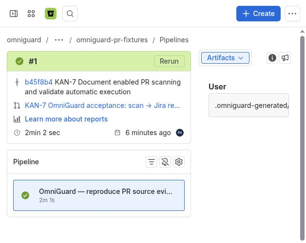
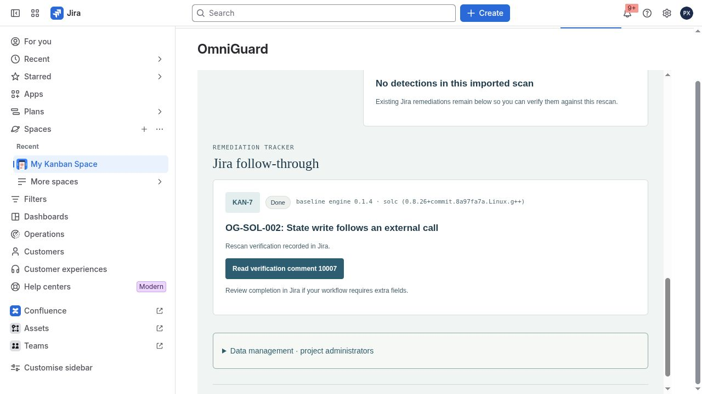

# Bitbucket PR → Jira acceptance — 14 November 2026

**Production remediation and automatic Bitbucket PR pipeline acceptance passed.**

The public [isolated fixture PR #1](https://bitbucket.org/omniguard/omniguard-pr-fixtures/pull-requests/1) was imported into OmniGuard on cs0lutions. It created [KAN-7](https://cs0lutions.atlassian.net/browse/KAN-7), rejected stale and mismatched evidence, accepted the fixed compiler rescan, recorded verification comment **10006**, and explicitly moved KAN-7 to **Done**. The existing manual-fixture KAN-6 remained Done with its earlier update time.

## Deployed boundary

| Component | Verified installation |
| --- | --- |
| Jira app | Production **3.0.0**, cs0lutions/KAN |
| Separate Bitbucket app | Production **2.0.0**, workspace **omniguard** |
| Integration packages | **0.1.5**; deployed code commit `2c2b73a0558f0c3c098076444813b3ca7e5ab1e6` |
| Rust engine | **0.1.4**, unchanged |
| Compiler | native solc **0.8.26+commit.8a97fa7a.Linux.g++** |

Both apps allow backend reads from `api.bitbucket.org`. The Bitbucket app has no repository write scopes, persistent storage, webhook or shared secret. Its temporary development installation was removed after the production panel passed, leaving one panel. Jira development remains separate. The temporary OGTEST site remains on Jira app 2.1.0 and was not used to claim acceptance of this extension.

## Evidence sequence

| Step | Observed result |
| --- | --- |
| Import vulnerable PR head | One OG-SOL-002 finding; exact source set and bytes validated in both apps |
| Create remediation | KAN-7, one issue bound to PR #1 and repository UUID |
| Commit only the source fix | Jira refresh reported “The pull request changed. Import its latest scan before continuing.” Verification was disabled |
| Import the stale report | Rejected with “PR source does not match report evidence: EffectVault.sol.” |
| Commit regenerated fixed report | Both production apps showed zero findings, the same full commit and evidence digest |
| Verify and complete | Comment 10006 recorded both heads, old/new source hashes and analysis profile; explicit Done transition succeeded |
| Check persisted outcome | Reload preserved the fixed scan and Done; Jira read-back returned one verification comment |

The source-only fix was deliberately committed separately to test rejection. Normal use commits source and regenerated report together. The fixture PR remains open as reproducible evidence; it was not merged or approved. No reviewers were assigned.

| Identity | Value |
| --- | --- |
| Repository UUID | `{39c1456b-b74e-4abd-88d2-5af180ff4ffe}` |
| Vulnerable source commit | `6a563ce962e57035d58ca1ab4e5d55e1d9732dcb` |
| Source-only fix commit | `01bbade7f8b23426a622997872ce9d4af184e68e` |
| Fixed report commit | `0bd63a6d188e65af008785fd3d9887051ad66948` |
| Destination commit | `7d12037d4d91fb7bde86849a124a6d445e8aa02a` |
| Vulnerable evidence digest | `144fc2c489d96c1da430e78c4b9a3dbfddc1c049f53afd055e740628abfae810` |
| Fixed evidence digest | `81639b6076cb558bbb5e7a0b26b92e89ccc91ee06fab91a32e85adc444168bcd` |

## Build and test evidence

**41 Jira/shared tests and 3 Bitbucket panel tests passed.** They cover URL and repository identity, source completeness/tampering, bounded reads, invalid UTF-8, opaque pagination, stale heads, cross-PR/manual substitutions, and the remediation flow. Both frontends and manifests passed. [GitHub CI run 43595542629](https://github.com/Protocol-X-01/OmniGuard/actions/runs/43595542629) passed Rust/compiler checks plus Forge, Bitbucket, dashboard and release integrity at the deployed code commit.

The local runtime dependency audit for the new Bitbucket package reported zero vulnerabilities. The complete development-tool tree reported 32 advisories (3 low, 19 moderate, 10 high), largely in Forge CLI transitive tooling; no forced major downgrade was applied. This is not a claim that all dependencies are vulnerability-free.

## Automatic pipeline acceptance

The earlier two-step-verification gate was resolved by the account owner. Pipelines was enabled for **omniguard/omniguard-pr-fixtures** using its existing build allowance. A documentation-only update to the open PR branch automatically triggered [Pipeline #1](https://bitbucket.org/omniguard/omniguard-pr-fixtures/pipelines/results/1), which completed successfully in **2 minutes 2 seconds** (scan step **2 minutes 1 second**). It was not a manually started run.

The unchanged [pipeline configuration](../integrations/atlassian-bitbucket/example/bitbucket-pipelines.yml) rebuilt engine commit `c5d49185802c8bfc7124d1252acc4f67e43efd1a`, verified native solc 0.8.26 checksum `d5f23436f443edb85d8e76906d12f0a86ce0490e7663a9e608efeb7a93f149ef`, generated JSON/SARIF and passed parsed-JSON equality against the committed bundle. The step retains its 15-minute maximum; no plan upgrade or integration credential was added.

The actual 4,018-byte artifact archive was downloaded and checked independently:

| Artifact | Verified result |
| --- | --- |
| [omniguard.scan.json](../reports/bitbucket-pr/pipeline-1/omniguard.scan.json) | Matches the committed fixed fixture and Jira's source/report content; 12-rule complete coverage, zero findings and diagnostics |
| [omniguard.sarif](../reports/bitbucket-pr/pipeline-1/omniguard.sarif) | SARIF 2.1.0, 12 rules and zero results |
| [source-commit.txt](../reports/bitbucket-pr/pipeline-1/source-commit.txt) | `b45f8b45849f7cc05deabea3e87bc009e6a6eeef`, matching the PR head and Jira import |
| [Validation receipt](../reports/bitbucket-pr/pipeline-1/validation.json) | Exact artifact SHA-256 values, run identity and comparison results |

That PR commit was imported into Jira with evidence digest `e03394020087d7d93fee7e61c2d6d67139f4efd5a51c0199bfa9d9287fe2591a`. Verification comment **10007**, created at **14:52:14 UTC**, records its source/destination commits and matching compiler profile. KAN-7 remains **Done**; comment 10006 preserves the earlier fixed commit. No new issue was created or reopened. This updates the PR evidence after a documentation-only commit, so the Solidity source hash remains unchanged.

Pipeline success proves this report was reproduced for the selected source commit. It does not mean every vulnerability is absent. No merge requirement or automatic Jira transition was installed. GitHub CI remains separate evidence; no Rust or Forge runtime changes were needed for activation.

Imports and Jira transitions remain deliberate reviewer actions. Public isolated fixtures only; private repositories, fork PRs, automatic issue closure and scanner execution attestation are outside this version. Current-head checks are time-of-check checks, not an atomic lock across products. The privacy notice was updated to version 3 for the public source reads and stored PR provenance. The original submission, video and v0.1.4 release assets remain unchanged.
