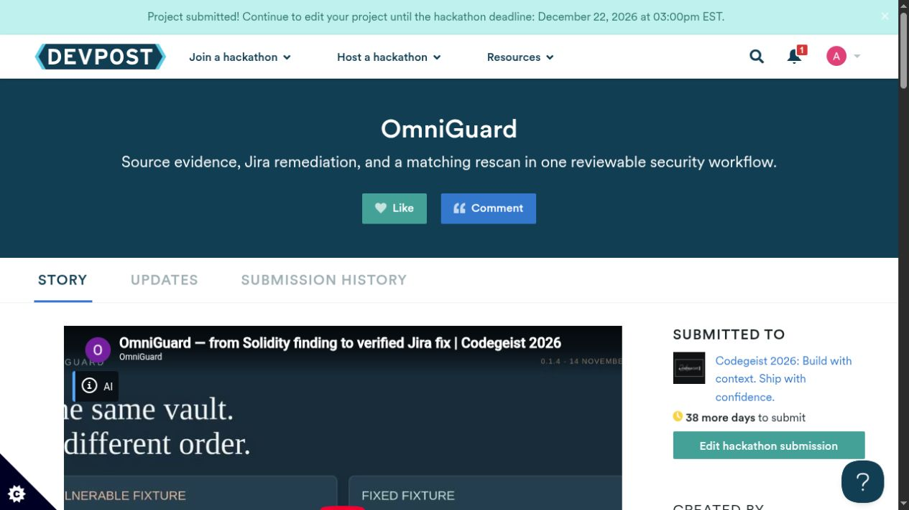

# Codegeist 2026 submission — 14 November 2026

**Submitted:** [OmniGuard](https://devpost.com/software/omniguard-z1pmcg), in **Apps for Software Teams**. No bonus category was selected.

After the entrant explicitly approved accepting the final Official Rules and Devpost Terms, the final agreement was checked and **Submit project** was selected once. Devpost redirected to the project page, displayed **Project submitted!**, and showed **Submitted to — Codegeist 2026: Build with context. Ship with confidence.** The confirmation was observed at 11:50 UTC on 14 November 2026.

The entry contains the reviewed project story, dedicated 3:2 cover, two captioned development/production evidence screenshots, the public 3:51 walkthrough, the Forge production installer and complete isolated-fixture judge instructions. AI assistance and synthetic narration are disclosed. [Public distribution metadata](distribution.json) records the project URL and submission identifier.

The submitted implementation is engine **0.1.4** and Forge production **2.1.0**. The source at submission was `c76aaca77184a4ed1358d47cdd5e7c86ff211edc`; both jobs in [CI 43590911800](https://github.com/Protocol-X-01/OmniGuard/actions/runs/43590911800) passed. Subsequent status-documentation updates do not change the scanner, Forge runtime, fixture sources or report bundles.

The [entry review](entry-readiness-2026-11-14.md) maps the delivered vertical slice to its evidence. Separate-site acceptance used the same administrator account, not an independent reviewer. The Bitbucket package remains a separate unregistered scaffold. No custom Rovo, Teamwork Graph, Marketplace or Atlassian MCP bonus integration is claimed.

Submission confirmation is distinct from judging or an award. Devpost states that the entry can still be edited until **22 December 2026, 15:00 EST / 12:00 Pacific / 20:00 London**. Earlier dated records describing an unsubmitted draft remain historical.
