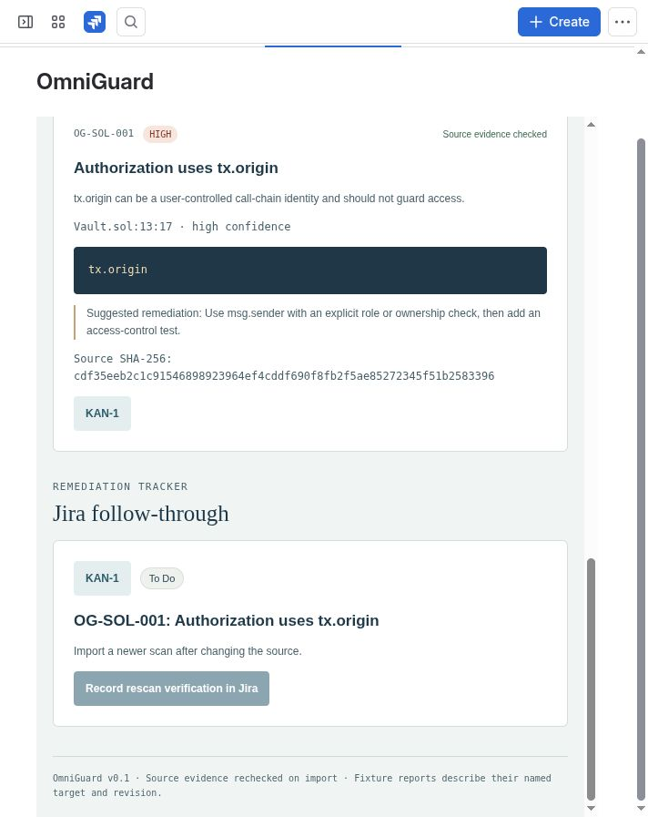
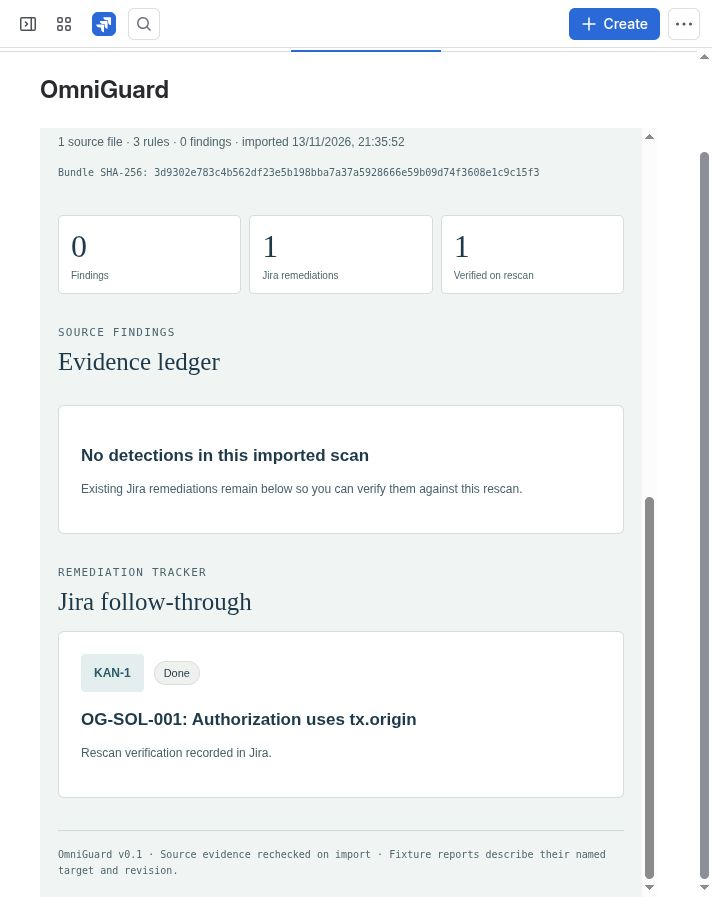
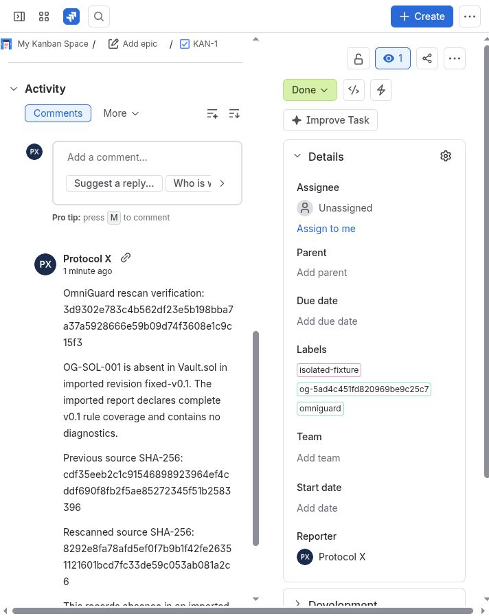

# cs0lutions live acceptance — 13 November 2026

**Historical engine/profile:** this record describes engine 0.1.0 and the original static Vault fixture. Its exact bundles are preserved under `reports/legacy/v0.1.0/`; root report paths contain the current engine profile. The original fixture lacked a deposit path, so its reentrancy finding was a static statement-order indicator. See `docs/rule-pack-results.md` for the complete executable vault witnesses.

**Later upgrade check:** development app 2.2.0 adds the 0.1.1/schema-v2 profile. A full page reload confirmed that the historical fixed scan, KAN-1 Done status and verification remain intact and labelled with baseline engine 0.1.0. [Screenshot](evidence/forge-engine-upgrade-preserved-history.jpg). This is a migration compatibility check; the full new-profile tenant flow remains untested.

**Result: passed for the isolated fixture workflow on the real Jira tenant.**

## Deployment

- Developer Space: **cs0lutions**; app: **OmniGuard**.
- App ID: `2dcc2164-b65e-43a5-90c8-bc4ac20447ab`.
- Environment: **development**; deployed version **2.1.0** (installation major version 2, up to date).
- Environment ID: `387fd4bc-0f29-4241-a471-dbf1e9edbf96`.
- Installation ID: `bb5bc961-15fb-4a9e-9e93-a4873d136a46`.
- Site/project: **cs0lutions.atlassian.net / KAN**.
- Scopes: `read:jira-work`, `write:jira-work`, `storage:app`.
- [Open OmniGuard](https://cs0lutions.atlassian.net/jira/software/projects/KAN/apps/2dcc2164-b65e-43a5-90c8-bc4ac20447ab/387fd4bc-0f29-4241-a471-dbf1e9edbf96).

The user signed in to Forge CLI locally and explicitly accepted Atlassian's developer terms, privacy policy and usage-billing agreement. Credentials stayed in the local CLI/keychain workflow. This is a developer installation, with production sharing and judge distribution still pending.

## Observed sequence

1. Generated both bundle files by invoking the release Rust CLI over the isolated fixtures.
2. Imported `vulnerable.omniguard.json` through the installed Jira app. Forge rechecked source integrity and displayed **3 findings**, 1 file, 3 rules and no diagnostics.
3. Selected `OG-SOL-001` and created **[KAN-1](https://cs0lutions.atlassian.net/browse/KAN-1)**: `[OmniGuard fixture] OG-SOL-001: Authorization uses tx.origin`.
4. Inspected KAN-1 in Jira: Task type, To Do status, fixture labels, exact `tx.origin` excerpt at `Vault.sol:13:17`, remediation advice, source digest and scan digest were present. It was unassigned; its only watcher was the current user.
5. Imported `fixed.omniguard.json`: **0 findings**, same target, changed source digest, complete coverage and no diagnostics. The original Jira record remained linked.
6. Used **Record rescan verification in Jira**. Jira comment **10000** contains the fixed bundle reference, rule/file, old/new source hashes and imported-scan qualification. [Verification comment](https://cs0lutions.atlassian.net/browse/KAN-1?focusedCommentId=10000).
7. Reviewed the fixture change: `msg.sender` replaces `tx.origin`, the state update precedes the external call, and both call results are checked.
8. Used the app's available **Move to Done** transition. Jira and Forge both confirmed **Done**.
9. Fully reloaded the Forge and Jira pages. The fixed scan, single remediation, verification and Done status persisted. Jira displayed the matching verification comment.

The user selected the two report files in the native file picker because browser automation could not capture that embedded chooser. The report import, issue creation, verification and transition were exercised through the actual installed Forge interface. No live-chain transaction or remote repository scan was performed.

## Evidence hashes

| Evidence | SHA-256 |
| --- | --- |
| Vulnerable scan bundle | `85aa47e07ae0e93f74b0ed8603e136e054200ac069c8df964f597bc2921ec3f9` |
| Fixed scan bundle | `3d9302e783c4b562df23e5b198bba7a37a5928666e59b09d74f3608e1c9c15f3` |
| Vulnerable Vault.sol | `cdf35eeb2c1c91546898923964ef4cddf690f8fb2f5ae85272345f51b2583396` |
| Fixed Vault.sol | `8292e8fa78afd5ef0f7b9b1f42fe26351121601bcd7fc33de59c053ab081a2c6` |

Bundle hashes use the validator's normalized serialization, rather than the pretty-printed file bytes.

## Local and platform checks

- **9 Forge tests passed**, including the real SDK entrypoint, bundle tampering, complete service workflow, duplicate/concurrent requests, uncertain Jira outcomes, rejected-request recovery, project isolation and incomplete/stale rescans.
- Authenticated Forge lint: **no issues**. Full manifest validation and frontend build passed.
- Current runtime dependency audit: **0 vulnerabilities**. The full Forge toolchain has 6 development-only low/moderate advisories (1 low, 5 moderate), retained with pinned Atlassian tooling.
- Separate Bitbucket scaffold: full manifest validation passed. It is not registered or installed.
- Earlier same-day Rust validation: **7 tests and release build passed**; Rust source remained unchanged during Forge setup.

The first development deployment exposed a CommonJS/default-import incompatibility in the resolver constructor. Version 2.1.0 uses the SDK's named exports and adds an entrypoint regression test; the full live sequence above ran on 2.1.0.

## Screenshots

## Remaining submission work

Prepare production sharing and test the installation from a separate judge account/site, record the public demo video, pin the release revision, and finish Devpost materials. The independent Bitbucket scaffold still needs repository/PR/commit binding before it can describe live pull request findings. See the [draft judge guide](judge-guide.md).
