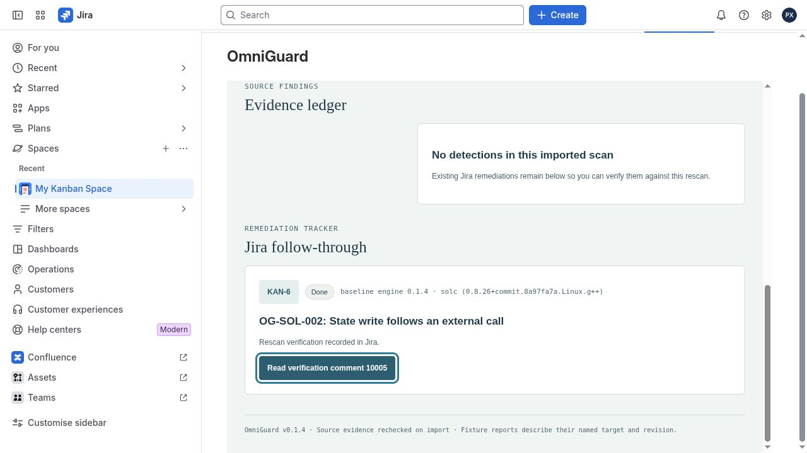

# Production Jira acceptance — 14 November 2026

**Passed on cs0lutions:** production Forge 2.0.0, engine 0.1.4. [KAN-6](https://cs0lutions.atlassian.net/browse/KAN-6) is Done with rescan verification comment 10005. The production environment is `a4939489-fd49-4ef6-a1fa-f0c98c1bf694`. Development 2.9.0 remains installed separately.

1. Imported the compiler-assisted vulnerable bundle: one OG-SOL-002 finding, 12-rule coverage, solc 0.8.26.
2. Reviewed the helper call, actual external interaction and later aliased storage write; created the real Jira remediation.
3. Imported a zero-finding source-only fixed report. Verification stayed disabled because its analysis profile differed.
4. Imported the matching compiler fixed report. Recorded comment 10005 with the fixed bundle and before/after source hashes, then explicitly moved the issue to Done.
5. Reloaded the production app. The fixed report, Done issue and verification persisted. The Atlassian connector independently read the actual issue and comment.

The [sanitized Jira record](evidence/production-jira-verification.json) retains the issue baseline and verification text. [Fixture provenance](../reports/judge/provenance.json) records file hashes and exact changes from the earlier validated demonstration bundles: target ID/name and revision only. Source and analysis-report bytes are unchanged. This milestone did not rerun the scanner or EVM witnesses.

The canonical bundle digests are:

- Vulnerable: `71ee7367472b73c9354c8c8d678a92539a1e7e525386450931730d04867a11fa`
- Weaker source-only rescan: `dd61ef29620edaa3bd23f832bc768b9ddce1aa194e011edfee237a5735e9dd6a`
- Matching fixed rescan: `168b2f00049542687408b3ba1f4b543fdac351d17d51ecbf6380a930f4300293`

These are Forge's normalized bundle digests, not the downloaded file hashes. Verification records absence of the named rule in the imported report; it is not a general security guarantee. This own-site acceptance does not establish installation on a separate judge site.

Jira-only distribution is enabled with the [public privacy notice](https://cs0lutions.atlassian.net/wiki/external/YWQ1ZWRkNDFiMzVlNGZkY2JlZmJkOGY5MTNhNzYzNGI) and support protocolx76@gmail.com. The app declares personal-data storage accurately. The [installation link and metadata](distribution.json) are intentionally public. No live-chain transactions, external scanner service, Marketplace publication or Bitbucket deployment occurred.
