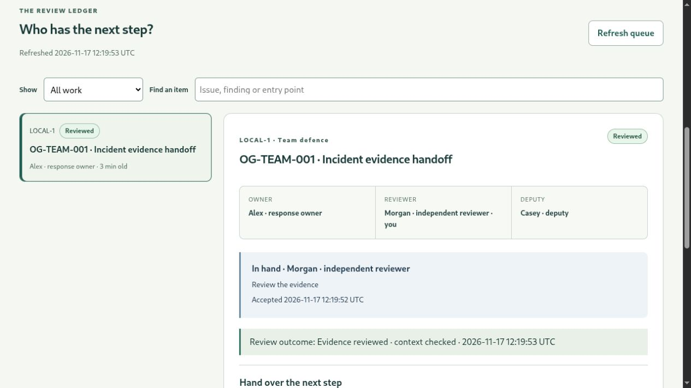
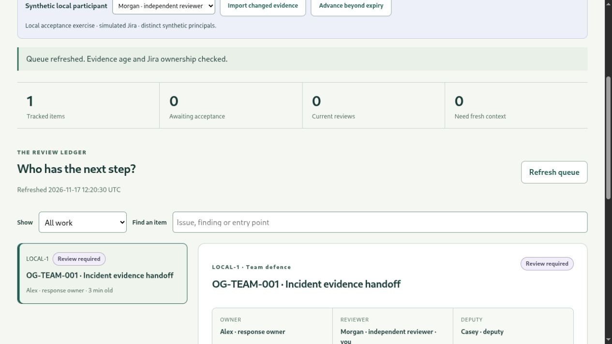
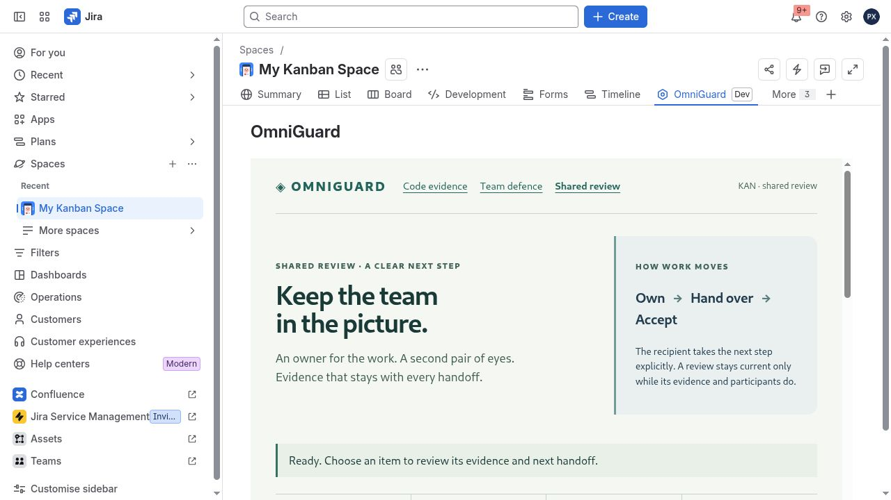

# Shared review queue — 17 November 2026

The queue is implemented and deployed to Forge development on cs0lutions. It joins existing code remediations and team-defence cases, with Jira ownership, independent reviewer/deputy roles, evidence age, explicit handoff acceptance and preserved receipts. Production has not been promoted.

## Local acceptance

Two separate browser tabs used distinct synthetic owner and reviewer principals against the actual queue service with simulated Jira. The reviewer took responsibility, the owner requested a handoff, the reviewer accepted and recorded a review of the displayed evidence. Reload retained the review and receipts. A changed evidence digest invalidated both acceptance and review while preserving history. A third synthetic deputy was included in the subsequent capture. These are separate local principals, not independent live Atlassian accounts.

Narrow-screen validation at390px reported document width375px, labelled inputs/selects and keyboard navigation to Refresh. This is browser reflow evidence, not a screen-reader certification or physical mobile test. [Browser acceptance](evidence/review-queue-2026-11-17/browser-acceptance.json).

The Forge integration suite passed79tests, including12new queue/HTTP cases covering owner self-review, wrong recipient, independent review, deputy handoffs, evidence/owner/role changes, stale revision, future/expired evidence, project/issue access, concurrent writes, abandoned locks, failed storage, PR provenance, incomplete coverage and source import-age preservation. The11-request local Postman collection passed20assertions with zero failed requests/assertions. OpenAPI and collection lint, frontend build and Forge manifest/lint checks passed. The local adapter is loopback-only and cannot enroll arbitrary issues or client-supplied actors in Forge.

## Forge development observations

Development3.7.0 rendered existing code and team records, with old/missing evidence visibly blocked. A fresh authorized native-solc fixture was imported through the actual app, creating [KAN-9](https://cs0lutions.atlassian.net/browse/KAN-9), still To Do. Its bundle SHA-256 is `2dc96fbc66878fb3c797794becd338c16fa3e45be3fb00e281ea710f2188d3a5`.

The single signed-in account took the review role while the issue was unassigned. The stored role survived refresh. After the issue was assigned to the same account, the queue read the new owner and exposed no independent-decision action. The temporary reviewer role was released; reload retained two role receipts and the real Jira owner. No live independent approval, handoff acceptance or Jira completion is claimed. [Development acceptance details](evidence/review-queue-2026-11-17/forge-development-acceptance.json).

## Evidence and limits

The current source includes small presentation refinements after3.7.0: unknown-age wording and an explicit same-account reviewer explanation. Final development3.8.0 deployment and readback are recorded with the release receipt. A later local-preview navigation change affects only the loopback exercise. Source age means time since its original import; scan capture/execution is unknown. A 24-hour queue window cannot prove data truth. Handoffs and reviews are app records, with no automatic Jira notifications or issue completion. Evidence import/Jira assignment and KVS are not one atomic transaction; every read re-evaluates review validity. Account deactivation or Jira permission changes are enforced on new access/actions, but historical reviewer membership is not continuously attested. Two real independent Jira users, physical mobile and production acceptance remain open.

See [user and deployment instructions](shared-review-queue.md) and [technical contract](shared-review-queue-spec.md).
