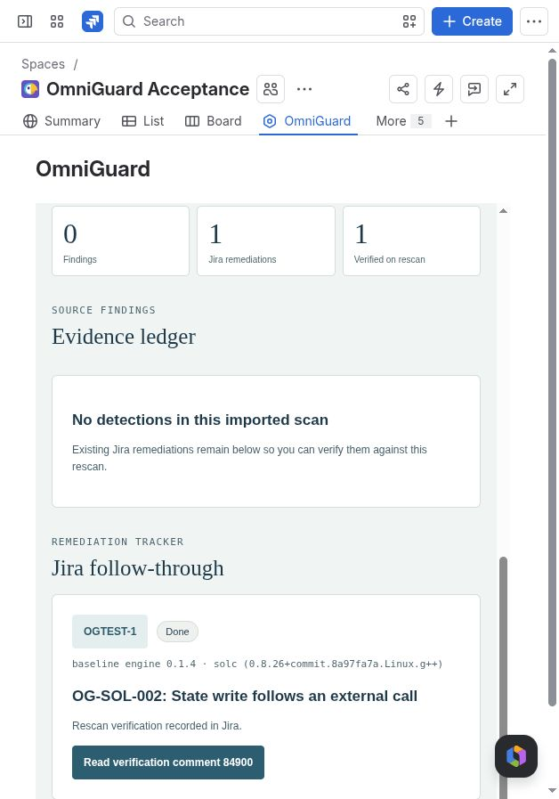

# Separate Jira-site acceptance — 14 November 2026

**Passed:** installation through the public distribution link, imported evidence, Jira remediation, weaker-rescan rejection, matching rescan verification, explicit Done transition, and reload persistence.

Forge production **2.0.0** / engine **0.1.4** was freshly installed on `one-atlas-vsdj.atlassian.net`, a temporary Forge demo site administered by the same owner. The owner explicitly approved its Jira read/write and app-storage access. The private **OmniGuard Acceptance** project (`OGTEST`, project 10202, Task type 10207) contains **OGTEST-1**, **Done**, with verification comment **84900**. The temporary site expires **12 February 2027**.

## Observed workflow

1. The public installer reported success; Forge's installation inventory independently listed production major version 2, up to date, installation `071ec49d-de1c-475b-a778-f78997469d85`.
2. The published vulnerable judge bundle imported with one OG-SOL-002 finding. The app checked source hashes, excerpts, spans and coverage. Its helper interaction and later storage write were inspected.
3. OmniGuard created the real Jira Task OGTEST-1. Its actual Jira description contained the source evidence, hashes and compiler baseline; the linked issue survived an app refresh.
4. The source-only fixed report had zero findings but disabled verification because its analysis/compiler profile did not match.
5. The matching solc fixed report enabled verification. Jira retained comment 84900 with the previous source hash `ea933c4380fd876fd25bff485be6980573cd25a8c67ff84841927fbc48ee18f8` and fixed source hash `18c00bd192c116d3b419c51b182f1301f41e602a5a9eb5e567b64860324635d8`.
6. The explicit completion action moved OGTEST-1 to Done. Full reloads of Jira and OmniGuard retained the fixed scan, issue, comment and Done status.

## Boundaries and recovery

The exact public `reports/judge/` bundles were used without modification. No scanner or app code, deployed version, dependencies or source fixtures changed. No live-chain transactions occurred. Import checks establish supplied evidence consistency, not scanner-execution attestation.

The first app navigation briefly returned 404 after installation; one reload recovered after propagation. The file-chooser event timed out without an import; the documented paste flow succeeded. No duplicate installation or issue was created.

This verifies a separate Jira tenant with the same administrator account. It does not establish acceptance by an independent reviewer account, all Jira workflows or production detection accuracy. The packaged v0.1.4 release and older recordings remain dated artifacts; this record supersedes their earlier second-site-untested status.
