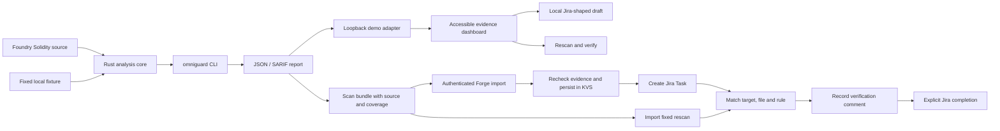

# Architecture

OmniGuard separates scanning from Atlassian workflow code. The shared boundary is the current JSON report contract in `contracts/report-v3.schema.json` (with historical v1/v2 compatibility), transported with source evidence in `contracts/scan-bundle-v1.schema.json`.

## Rust core

`omniguard-core` owns AST parsing, detection, report types, and evidence validation. The `tree-sitter-solidity` parser supplies node types and byte spans. Rules look at syntax-tree relationships; they do not use regex-only whole-source matching.

Before a finding is serialized, its relative path is resolved under the scan root and the core verifies the current file digest, UTF-8-safe byte span, exact excerpt, and one-based line/column. A changed file makes the evidence invalid. Findings sort by normalized file, byte offset, then rule ID.

## CLI

`omniguard-cli` discovers Solidity files in the selected path, reads a Foundry source directory when `foundry.toml` is present, and emits text, JSON, or SARIF 2.1.0. The `--fail-on` option is for CI gating; no scanner finding is treated as proof that a contract is exploitable.

## Local demo adapter

The Node API is bound to `127.0.0.1`, permits only the dashboard's development origins to create a draft, and re-runs the CLI before accepting a finding ID. It stores drafts in memory for one demo process. The UI calls the same CLI for the fixed fixture and labels all drafts as local.

## Forge boundary

The Jira Forge package contains its own manifest, Node resolver, Custom UI, pure report validator and remediation service. It has no Rust runtime dependency. The local bundle generator invokes the Rust CLI over the selected source/compiler fixture scenarios. The authenticated import resolver verifies source digests, UTF-8 spans, excerpts, positions, fingerprints and coverage, then writes the scan and active pointer atomically to installation-scoped KVS. Source integrity does not attest scanner execution; the uploader and named fixture revision remain part of the trust boundary.

Jira writes run as the current user, in the project from the resolver context, after explicit UI actions and permission checks. Issue types and completion transitions come from Jira metadata. Persistent claims prevent duplicate creation on concurrent requests or uncertain network results. A rescan can verify absence only with the same target, engine/rule/mode/compiler profile and file, changed source, complete coverage, no diagnostics and no remaining instance of that rule in the file. Completing the issue additionally requires a current verification and an available Done-category transition.

The Bitbucket scaffold has a separately registered app boundary under `integrations/atlassian-bitbucket/`. Atlassian's current multiple-app model supports Jira and Confluence. Repository fetching, commit/PR binding and authenticated report transfer for Bitbucket remain pending.

## Expanded core model

Engine 0.1.4 separates the rule registry from the scoped AST analysis. It resolves local declarations, contract storage roots and unambiguous in-source interface methods, checks simple caller guards before sinks, separates disjoint/terminated branches and follows bounded unmodified local aliases. Native compiler mode additionally constructs ordered effects from declaration identities and directly expands bounded helpers, modifier bodies and storage aliases. Branch/termination alternatives remain separate; unsupported effects produce diagnostics. Related evidence records the declarations, call chain and writes that support a result. Every primary and related span is validated against its own source digest, including cross-file compiler declarations. Coverage records every input digest, and native bundle export rejects a source snapshot change even for a finding-free file.

Optional native-solc Standard JSON supplies a global declaration/type index for the exact selected snapshot. The driver disables import callbacks, bounds input/output and deadlines, and treats compiler JSON errors as incomplete even if the process exits successfully. Those facts improve receiver typing, overload resolution and inherited storage identity. The model has no whole-program IR or full path reasoning yet. The current limitation and measurement gate is documented in `docs/rule-pack-results.md`; rule identifiers and metadata are generated from the Rust registry, not duplicated by hand in Forge.
