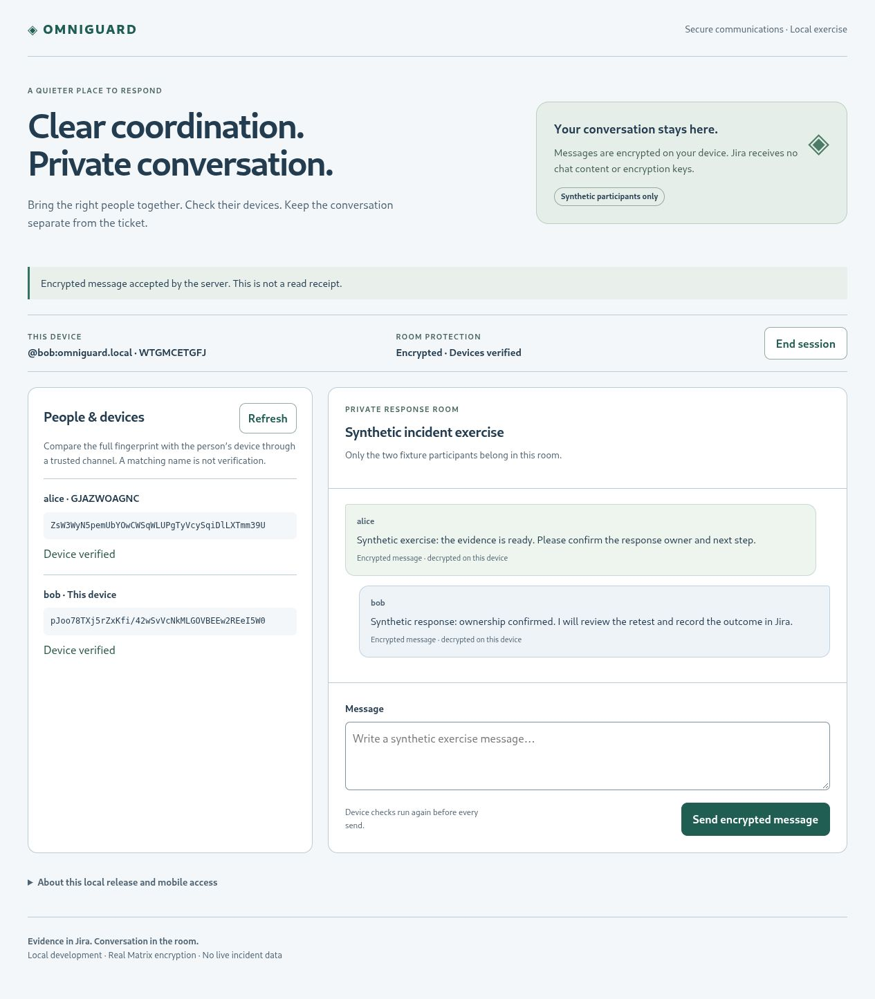
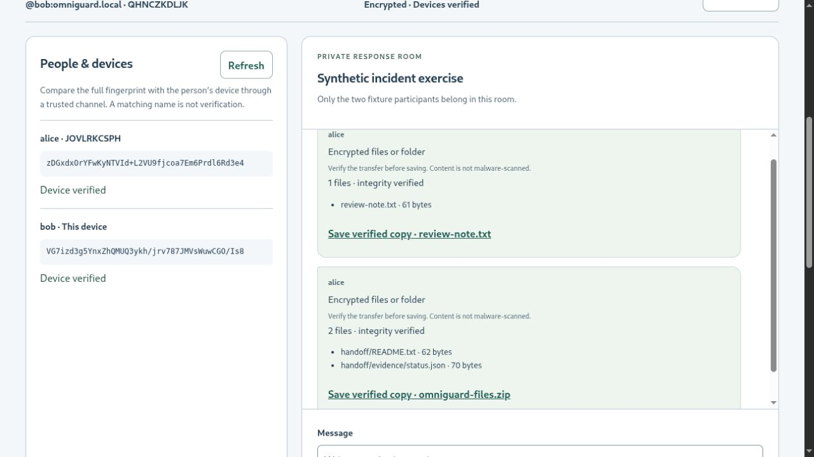

# Messaging and team coordination

Security work depends on a clear handoff: who owns the response, what needs attention, and which evidence supports the next action. OmniGuard's development work brings reviewed owner contact into Jira and explores a separate encrypted space for team conversation.

**Availability: dated Jira/messaging evidence from 14 November; transfer browser evidence from 17 November 2026.**

| Capability | Accepted environment | What a public installer provides today |
| --- | --- | --- |
| Scan evidence, Jira remediation and compatible rescan verification | Jira production 3.0.0 on cs0lutions | Existing production workflow; see the [judge guide](judge-guide.md) |
| Team-defence workflow and reviewed owner mentions | Forge development 3.6.0 on cs0lutions | Development capability; not in the public production installer |
| Encrypted conversation between verified fixture devices | Separate local browser app and loopback Synapse server | Local development lab; no public messaging service |

The repository now includes the team-defence and messaging implementation source, tests and local setup instructions. The tagged v0.1.4 release and production Forge installation remain separate from this source update. See the [current project status](project-status.md) for the evidence and demo revision.

## Contact the person responsible

The development **Contact owner** action reads the issue's current Jira assignee. The reviewer chooses a supported reason, sees the intended recipient and exact message, and explicitly confirms the mention. The service checks permissions and the assignee again before adding the Jira comment.

A short-lived review binds the actor, recipient, issue, evidence and message. Persistent receipts prevent a repeated click from sending the same mention again; an uncertain write is not blindly retried. The contact record preserves the comment reference without retaining a raw recipient account ID or display name in Forge storage. Contact does not change verification or mark an issue complete.

The measured exercise recorded one self-mention on synthetic issue KAN-8, kept the issue Done and retained its receipt after reload. This establishes a real Jira mention, not online presence, notification delivery or a read receipt. A second human reviewer was not tested. The broader development suite recorded 67 passing Jira/shared tests.

[Sanitized Jira acceptance](evidence/messaging-2026-11-14/owner-contact-acceptance.json).

## A separate encrypted conversation

*Authentic, unchanged browser capture from the local lab. Alice and Bob are synthetic participants. Displayed device fingerprints are public verification material, not secret keys.*

The browser application uses Matrix JS SDK 45.1.0, its Rust crypto implementation and a local Synapse 1.165.0 server. Each participant compares the other device's full fingerprint through an independently trusted channel before verifying it. The browser encrypts message content; the recipient decrypts it. Chat messages, encryption keys and Matrix access tokens do not pass through Forge or Jira.

Before each send, the client checks encryption, invite-only room policy, expected membership and current verified devices. A wrong fingerprint, new unverified device, changed membership or unavailable encryption blocks sending. There is no plaintext fallback. The interface shows only successfully decrypted encrypted messages in its protected transcript.

Two-way messages were accepted in two real browser sessions. Two local tests passed without skips, including real-server ciphertext, recipient decryption, outsider join/read denial and send-block checks. Inspection of stored server events found encrypted content and no test-message plaintext. A 390px browser layout had no horizontal overflow; this was not an Android or iOS device test.

[Crypto acceptance](evidence/messaging-2026-11-14/crypto-acceptance.json) · [Browser acceptance](evidence/messaging-2026-11-14/browser-acceptance.json) · [Capture and source provenance](evidence/messaging-2026-11-14/provenance.json).

## Encrypted files and folders

The [local transfer extension](../secure-comms/TRANSFERS.md) encrypts file contents, names and nested paths before uploading ciphertext through Matrix Attachment v2. Each transfer is bounded to 100 files and 10 MiB of file content. The recipient checks the verified sender device, encrypted event provenance, bundle bounds, safe paths and per-file hashes before an explicit **Save verified copy** action. A multi-file handoff becomes a ZIP locally; received content is never automatically opened, unpacked or executed.

On 17 November, real browser pickers selected a single file and a nested folder. The recipient verified and saved both. Independent byte comparisons confirmed the single-file copy and every path and file in the downloaded ZIP. The prior 16 November real-server suite passed 13 tests, including corruption and changed-device/membership rejection. These are synthetic local measurements; encryption is not a malware verdict, metadata remains visible to the homeserver, and saved copies cannot be recalled.

[Browser acceptance](evidence/transfers-2026-11-17/transfer-browser-acceptance.json) · [Run the local lab](../secure-comms/README.md).

## What remains before real team use

The lab uses a loopback-only fixture session issuer, synthetic accounts and memory-only browser keys. It is unsuitable for real users or confidential incident details. It has no durable key recovery or production authentication. The homeserver can still see membership, device IDs and timing; encryption does not protect a compromised endpoint or erase content already read.

A future pilot needs reachable HTTPS hosting, real identity and access lifecycle controls, verified clients, encrypted key backup and recovery, independent security review and physical Android/iOS acceptance. The current lab should stay on loopback. Jira's ordinary issue comments and notifications remain a separate coordination channel; the Forge interface is not presented as a native mobile messenger.

The dated records above describe bounded synthetic acceptance. They are not a security certification or proof that every attack or device is covered.
