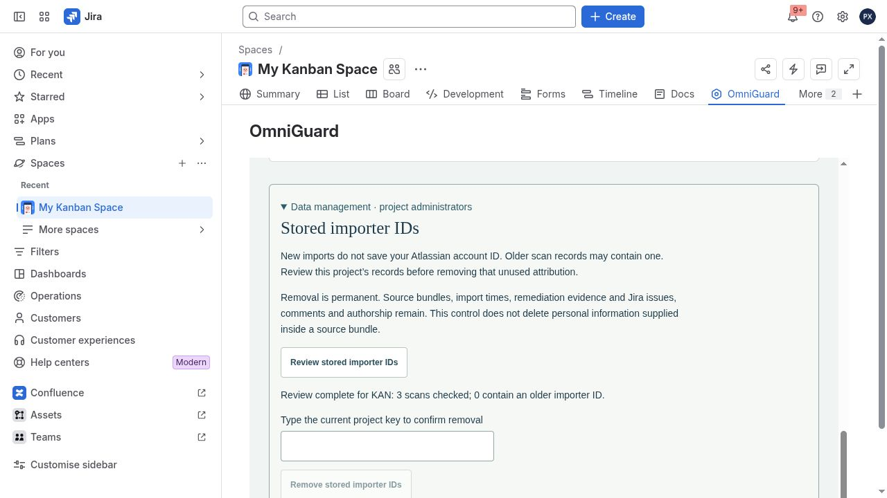

# Importer-data minimization

This change stops saving the authenticated importer's Atlassian account ID in new scan records. The workflow does not use this field: it is absent from the public scan model, source-evidence validation and remediation comparison. Jira retains the authorship of actions performed through its own current-user API.

The change was merged in [PR #1](https://github.com/Protocol-X-01/OmniGuard/pull/1), deployed to development as 2.10.0 and to production as 2.1.0 on 14 November 2026. No historical attribution is removed just by opening the dashboard or deploying this change.

## Administrator workflow

1. Open OmniGuard in the relevant Jira project and expand **Data management · project administrators**.
2. Select **Review stored importer IDs**. The server verifies `ADMINISTER_PROJECTS` against the authenticated project, then returns counts without account IDs or source text.
3. Review the counts and permanent-removal notice. Type the exact project key to enable **Remove stored importer IDs**.
4. The server rechecks both project-admin permission and the confirmation on every page. It removes only the legacy `importedBy` property from scan snapshots in that project and installation.
5. Run the review again to check the current result. A completed pass reports counts; an interrupted pass reports incomplete progress and can be safely repeated.

The operation preserves source bundles, import times, findings, digests, remediation baselines, Jira issue links, verification references and native Jira authorship. It does not remove personal information included by an uploader inside a source bundle or copies in Jira. Those requests require a separate, scoped review; the existing support contact and personal-data declaration remain appropriate.

## Storage and failure behavior

Each backend request handles at most 20 records. The UI follows up to 100 pages and explicitly stops with an incomplete result if that limit or an error is reached. This is an early-access fixture app; larger inventories need a support-led cleanup, not an unverified clean claim.

Pagination cursors are held only during the current interaction. They are not stored as durable checkpoints. Every returned key must match the server-derived project prefix and a scan digest before any record on that page is changed. A strongly consistent `get` rereads each record before the update, because KVS queries are eventually consistent.

Scan snapshots are otherwise immutable. Re-importing an existing digest now changes only the active pointer, preventing a stale import from restoring attribution removed concurrently. Interrupted removals are idempotent. A failure can occur after some records on a page were changed, so the UI does not report an all-or-nothing result.

No new Forge scopes, scheduled job, external destination, reporting service or credential is introduced. Existing legacy IDs persist until an administrator explicitly removes them. Removing this one field is not a general certification of privacy compliance; user-supplied source and Jira copies remain in scope for privacy requests.

## Validation and references

The Forge suite contains 31 tests, including new cases for read-only pagination, permission and confirmation denial, project separation, stale reads, concurrent re-import and recovery after a storage failure. The existing scan-to-Jira tests remain part of that suite. Build, manifest validation and authenticated Forge lint passed.

Development 2.10.0 was deployed on 14 November 2026. Its actual KAN inventory initially showed 10 scans with legacy attribution. A new isolated fixed-vault import increased the inventory to 11 scans while the legacy count stayed at 10, demonstrating that this import did not save an account ID. The original fixed scan was restored; KAN-4 remained Done with verification comment 10003. An incorrect confirmation key kept removal disabled; the exact key enabled it.

After the owner approved the rollout and permanent field removal, production 2.1.0 deployed successfully at 11:03 UTC from merge commit `d54ee16664dd6d28bb04da140a373e2115dcf568`. It contains the exact runtime code tested at `dd19eb71590d83b2c47e5f3d7b16486de034bb88`; [both hosted CI jobs passed](https://github.com/Protocol-X-01/OmniGuard/actions/runs/43587493995).

| Approved project / environment | Scans retained | Importer IDs removed | IDs found after reload | Jira verification retained |
| --- | ---: | ---: | ---: | --- |
| cs0lutions / KAN development | 11 | 10 | 0 | KAN-4 Done, comment 10003 |
| cs0lutions / KAN production | 3 | 3 | 0 | KAN-6 Done, comment 10005 |
| one-atlas-vsdj / OGTEST production | 3 | 3 | 0 | OGTEST-1 Done, comment 84900 |

All three actions ran through the authenticated admin controls with the exact project key. A fresh page load and read-only inventory confirmed each zero count. The active source-bundle hashes, original import times and existing Jira verification references remained unchanged. No Jira issue, comment or transition was created by the cleanup. These checks cover the named project environments, not all possible installations or personal information inside source bundles.

The [public privacy notice](https://cs0lutions.atlassian.net/wiki/external/YWQ1ZWRkNDFiMzVlNGZkY2JlZmJkOGY5MTNhNzYzNGI) was updated to version 2 at 11:06 UTC to describe the new behavior and the limited removal control. The personal-data declaration remains **Yes** because uploaded source and remediation content may still contain personal information.

Atlassian recommends avoiding unnecessary cached personal data and provides reporting/erasure requirements for apps that retain it. This update minimizes a field that had no workflow consumer; cleanup of that field was verified only for the named project environments above. [Forge user privacy guidance](https://developer.atlassian.com/platform/forge/user-privacy-guidelines/).

The storage design follows the documented query consistency and cursor limits. [Forge KVS consistency and cursors](https://developer.atlassian.com/platform/forge/storage-reference/kvs/) and [KVS queries](https://developer.atlassian.com/platform/forge/storage-reference/kvs-api-query/). Sources checked 14 November 2026.

## Development owner contact and separate local messaging (14 November 2026)

Development 3.6.0 reads the current Jira assignee for a reviewed mention. Forge stores a per-project random signing secret plus comment receipt, reason, evidence digest and time; it does not persist the recipient account ID, display name, preview token or message body. Jira itself retains comment authorship and mention identity. No new Forge scopes or destinations were added. The public production privacy notice is unchanged because production is unchanged.

The separately running encrypted messaging lab is local-only, with synthetic users and owner-only server state outside the repository. The Matrix homeserver stores encrypted message content and visible room/device metadata; browser keys and access tokens are memory-only. The fixture broker has synthetic account credentials and is not production authentication. No Matrix data is sent to Forge. See its [trust boundaries](../secure-comms/SPEC.md).
