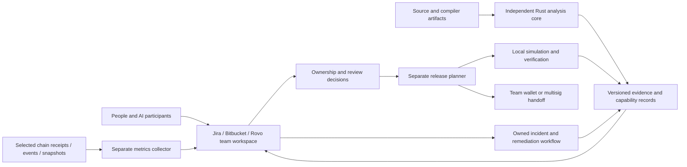

# OmniGuard: a workspace for people and AI to secure, ship and operate together

Proposed roadmap, 16 November 2026. **37 capabilities across nine team workflows**, including extensions to existing features. This is a development plan, not a claim that these capabilities have shipped. The organising unit is a team and its projects; a solo developer collaborating with AI is a supported team shape.

Every feature must solve a named user problem, have an accountable owner, define its check, retain reproducible evidence and expose its coverage status. People and agents can contribute different work, with their roles and provenance visible. Proposed owner roles below remain **unassigned to people** until the team assigns them.

## Verified starting point

The local Rust core already provides Solidity AST analysis, optional native compiler facts, twelve detectors, source-bound evidence and JSON/SARIF reporting. The [combined lab](../fixtures/combined-defence/README.md) records twelve detected patterns and ten demonstrated but undetected properties. The existing [Jira/Bitbucket workflow](architecture.md), [front-line intake](frontline-guide.md) and [owner contact](owner-contact-spec.md) provide a collaboration base. Dated acceptance records remain distinct from current hosted-state verification.

The encrypted messaging component is a [local lab](../secure-comms/README.md). The separate multi-chain MCP prototype in the surrounding workspace reports lexical indicators; it does not establish OmniGuard semantic coverage or a Forge MCP integration. The current native compiler driver requests ASTs, not a bytecode analysis pipeline. Existing source reports do not carry the new artifact, deployment or metrics records proposed below.

## Delivery order

- **P1 — Shared understanding:** team/project identity, ownership, a shared contract and artifact view, evidence-linked reviews, agent attribution and explicit gaps.
- **P2 — A complete local release story:** reproducible deployment plans, simulation, reviewer handoff, local post-deployment verification, fixture-backed metrics and incident routing.
- **P3 — Connected team operations:** selected external data sources, robust indexing, authenticated agent/graph integrations, operational messaging and measured multi-user acceptance.
- **P4 — Broader analytical depth:** protocol properties, deeper semantic/bytecode analysis and additional language/runtime profiles with independent validation.

These are dependency stages, not calendar promises. Small, tested portions can move earlier when prerequisites are satisfied. P1/P2 should strengthen the Codegeist demonstration; P3/P4 remain a visible product backlog where not delivered.

## 1. Shared team context

Proposed accountable role: collaboration maintainer. Depends on installation/project isolation and a consistent identity model.

| ID | Stage | Capability and team benefit | Acceptance evidence |
| --- | --- | --- | --- |
| F01 | P1 | Shared asset register connecting repositories, contracts, environments and deployments to an owner and deputy. | Two projects keep separate inventories; missing ownership and stale deployment identities remain visible. |
| F02 | P1 | Roles for developers, reviewers, release approvers, responders and agents, extending current Jira permissions. | Independent principals exercise allowed and denied actions; cross-project access, removed membership and stale permissions fail safely. |
| F03 | P1 | Coverage board showing each entry point, required check, owner, evidence age and unresolved gap. | A zero-alert report with an uncovered family or stale evidence cannot make that family appear covered. |
| F04 | P1 | Review requests, owner mentions, handoff notes, saved team views and notification preferences. | A handoff reaches its intended assignee once, retains its context, and reports delivery uncertainty without inventing online presence. |

## 2. Collaborative contract analysis

Proposed accountable role: analysis maintainer. F05/F06 depend on a versioned artifact model; F07 depends on independently labelled properties.

| ID | Stage | Capability and team benefit | Acceptance evidence |
| --- | --- | --- | --- |
| F05 | P1 | Shared contract workbench: entry points, ABI, roles, inheritance, storage, external interactions and call relationships. | A reviewer follows an entry point to the exact declarations and effects supporting a claim; unresolved relationships are explicit. |
| F06 | P1–P4 | Bytecode workbench: creation/runtime distinction, instruction decoding, selectors, source maps, control flow and later inferred pseudocode. | Fork-specific decoding, PUSH data, metadata and malformed inputs have fixtures; every claim links to a byte offset/code hash. Inferred information is labelled. |
| F07 | P1–P4 | Close the ten current gaps and deepen cross-function, modifier, alias and path analysis. | Each promoted property passes positive/fixed/negative cases plus independent variants; bounds or unsupported effects remain visible. |
| F08 | P1 | Shared evidence review, comments, disagreement, reproducible counterexamples and reasoned dispositions. | Reviews bind to an exact artifact/profile; a changed artifact invalidates an old approval while preserving discussion history. |

Solidity's compiler can expose ABI, storage layouts, bytecode, source maps, library link references and immutable references, providing a practical starting point for F05/F06. Recovering the original source from arbitrary bytecode is not an acceptance requirement. [Compiler output specification](https://docs.soliditylang.org/en/v0.8.26/using-the-compiler.html).

## 3. Team development and review

Proposed accountable role: developer-experience maintainer. Builds on F01–F08 and the existing PR evidence workflow.

| ID | Stage | Capability and team benefit | Acceptance evidence |
| --- | --- | --- | --- |
| F09 | P1–P2 | Security-aware PR differences: changed authority, new interactions, altered storage and findings against the proposed merge result. | Stale source/destination heads are rejected; a removed guard is explained even when filenames or lines move. |
| F10 | P2 | Shared rule profiles, review policies, temporary exceptions and expiry. | An exception has a reason, owner, scope and expiry; weaker or incompatible rescans cannot verify its baseline. |
| F11 | P2–P4 | Reusable team regression packs, generated test drafts and local invariant/fuzz/symbolic checks with budgets. | Tests reproduce the stated property; crashes, timeouts and untested paths are reported as such, and generated tests receive review. |
| F12 | P2 | Dependency inventory, compiler/settings provenance, reproducible builds and applicable dependency/compiler advisory checks. | A changed dependency or build setting changes the artifact identity; advisory relevance records assumptions rather than merely matching a name. |

Established analyzers provide useful comparison methods such as entry-point summaries, call graphs and upgrade checks. OmniGuard should retain its independent core and measure additions against declared cases rather than equating feature lists with analytical parity. [Slither's documented capabilities](https://github.com/crytic/slither#printers).

## 4. Deployment as a team workflow

Proposed accountable role: release-engineering maintainer. Depends on F01/F02, artifact identity, F08 and F12.

| ID | Stage | Capability and team benefit | Acceptance evidence |
| --- | --- | --- | --- |
| F13 | P2 | Shared deployment planner recording chain, environment, constructor/initializer arguments, libraries, intended roles and estimated costs. | The plan binds to the reviewed build; a changed chain, recipient, bytecode or argument requires a new assessment. |
| F14 | P2 | Deployment/upgrade rehearsal with readable transactions, traces, state changes and team-defined invariants. | Success, revert, wrong-role and storage-incompatibility cases are exercised locally with a recorded state snapshot. |
| F15 | P2–P3 | Reviewer-to-signer handoff supporting a team's wallet or multisig process and an explicit transaction lifecycle. | The signer sees the reviewed intent; timeouts and ambiguous broadcasts reconcile by transaction identity before any retry. |
| F16 | P2–P3 | Post-deployment source/runtime verification and a shared release timeline linked to PR, Jira issue and reviews. | Receipts, runtime code, implementation and configured roles match the expected deployment; mismatches prevent a verified-release claim. |

The user-facing flow is **select reviewed build → configure → simulate → review → sign through the team's wallet process → confirm → verify → observe**. The initial acceptance uses an isolated local EVM. Analysis and Forge components do not hold deployment keys. A deployment is not given a generic "rollback" button: recovery means a specific reviewed upgrade, pause or migration plan where the contract supports it.

Creation bytecode, returned runtime code and proxy implementation code must have distinct identities. Comparison records compiler/settings, constructor and initializer inputs, library links and immutable values. Any permitted normalization must be explained. Sourcify distinguishes exact source/metadata matching from other bytecode matches; a source match alone does not establish contract safety. [Sourcify verification model](https://docs.sourcify.dev/docs/exact-match-vs-match/).

Proxy handling starts with explicitly supported forms. ERC-1967 specifies implementation, beacon and admin slots; custom forms remain unresolved until supported. Upgrade review must also compare storage layouts and initialization assumptions. [ERC-1967](https://eips.ethereum.org/EIPS/eip-1967), [OpenZeppelin upgrade validation](https://docs.openzeppelin.com/upgrades-plugins/api-core).

## 5. Shared usage and operational metrics

Proposed accountable role: observability maintainer. Depends on F01/F16, a versioned metric definition and an indexer that can recover from missing or reorganized data.

| ID | Stage | Capability and team benefit | Acceptance evidence |
| --- | --- | --- | --- |
| F17 | P2–P3 | Contract usage: relevant transactions, participating addresses, function/event activity and configured business actions. | Counters reconcile to a known fixture; duplicate ingestion and replay do not inflate totals; address counts are not labelled human users. |
| F18 | P2–P3 | Reliability and cost: successful/failed transactions, gas, supported fee components, confirmation delay and data freshness. | Reverted, pending, missing-receipt and stale-provider cases remain distinguishable; unavailable data is not shown as zero. |
| F19 | P2 | Team outcome metrics: unowned coverage, stale evidence, review delay, verified remediation time, recurrence and release verification. | Every metric has an explicit denominator and time window; project aggregates reconcile to underlying work records. |
| F20 | P3 | Shared alerts for implementation/role changes, abnormal failure patterns and selected operational thresholds. | Reorgs retract invalid observations; deduplication, routing, acknowledgement and recovery are exercised without alert storms. |

### Metric definitions

| Metric | Proposed definition | Boundary shown to the team |
| --- | --- | --- |
| Relevant transactions | Distinct transaction hashes under a documented contract/interaction attribution method, per chain and window. | Direct calls, internal calls and events have different coverage; missing traces remain visible. |
| Participating addresses | Distinct addresses attributed to selected actions. | Wallets, routers, relayers, bots and people are not interchangeable. |
| Failure rate | Failed known receipts divided by classified receipts for the selected interaction population. | Pending or missing receipts are shown separately; events alone cannot supply this population. |
| Usage by function/action | ABI-decoded calls or configured event-derived business actions. | Ambiguous selectors and unavailable ABIs remain unknown; changing the ABI changes the metric version. |
| Gas and cost | Recorded gas and chain-supported fee fields with units and components. | Estimated fees and settled fees are separate; token/fiat conversions require a dated price source. |
| Protocol revenue / value held | Explicit protocol-specific accounting definition using selected events/state and assets. | Transfers are not automatically revenue; unsupported pricing or accounting produces unavailable values. |
| Time to verified remediation | Time from recorded finding triage to a matching accepted rescan, with unresolved cases also displayed. | Closing an issue without matching evidence does not count as verification. |
| Team coverage | Required checks grouped by owner, artifact/profile, freshness and capability status. | Known gaps and unsupported analyses remain separate from completed checks. |

Receipts expose transaction status, gas and logs; log records can identify removals caused by reorganizations. The proposed collector therefore tracks block hashes, persistent cursors, deduplication keys, finality state and data freshness. It uses a local fixture store first; any hosted store is a later operational choice. [Ethereum JSON-RPC specification](https://ethereum.org/en/developers/docs/apis/json-rpc/).

## 6. Incident coordination and shared learning

Proposed accountable role: response-workflow maintainer. Extends front-line intake, Jira ownership and the communications lab.

| ID | Stage | Capability and team benefit | Acceptance evidence |
| --- | --- | --- | --- |
| F21 | P2–P3 | Unified intake for findings, suspicious requests, deployment changes and operational alerts. | Related signals join a case without losing provenance; unrelated projects cannot see each other's incident data. |
| F22 | P2–P3 | On-call ownership, escalation, runbooks, incident roles and handover. | A rehearsal shows who responds, what is pending and who takes over; acknowledgement is distinct from delivery. |
| F23 | P3 | Authenticated encrypted incident rooms with device verification, membership changes and recovery. | Multi-member/device tests cover revocation, changed membership and recovery; the current fixture broker is replaced before production use. |
| F24 | P2–P3 | Decision records, post-incident review and reusable regression cases linked to Confluence/Jira knowledge. | A future reviewer can trace the decision to evidence and test a recurrence; visibility follows the source permissions. |
| F37 | Local lab → P3 | Encrypted file and folder handoffs in verified team rooms, with reviewed selection and explicit recipient downloads. | [Local transfer contract](../secure-comms/TRANSFERS.md): binary/nested-file round trips, hidden filenames, tamper/path/size rejection and membership changes; browser, production lifecycle and physical mobile acceptance remain gates. |

## 7. Access wherever the team works

Proposed accountable role: platform-integration maintainer. Depends on F02 and a common artifact/project identity.

| ID | Stage | Capability and team benefit | Acceptance evidence |
| --- | --- | --- | --- |
| F25 | P1–P3 | Context-aware entry points through Jira, Bitbucket, Confluence, IDEs, Forge-native MCP and Teamwork Graph relationships. | Each integration retrieves the same permitted artifact/review context; native MCP and Graph operations are demonstrated before claiming their integration. |
| F26 | P3 | Mobile incident summaries, owner contact and review handoffs through supported applications. | Real Android/iOS acceptance checks authentication, notifications, deep links and revocation; browser reflow alone does not qualify. |
| F27 | P1 onward | Accessible collaborative views: keyboard and screen-reader paths, readable diffs, reduced motion and eventual localization. | Two participants complete the review/handoff flow without relying on colour, pointer input or a wide screen. |
| F28 | P3 | Team data controls: export, retention, redaction, regional/self-host options where feasible and explicit sharing boundaries. | Export/delete/restore and tenant-isolation checks preserve intended evidence; no secret or unrelated source is included in a shared bundle. |

## 8. Broader protection with measured depth

Proposed accountable role: research and validation maintainer. Depends on the artifact model, F07/F11 and runtime-specific expertise.

| ID | Stage | Capability and team benefit | Acceptance evidence |
| --- | --- | --- | --- |
| F29 | P4 | Additional language/runtime profiles, beginning with demand-backed Vyper, Move, Anchor Rust or Cairo work. | Each profile declares parsing, type resolution, rules, execution witnesses and limits; the separate lexical MCP baseline does not count as semantic validation. |
| F30 | P4 | Protocol review packs for accounting, oracles, signatures, governance, bridges and bounded economic/state-machine properties. | Assumptions are explicit; independent scenarios, negative controls and time/resource limits accompany every property claim. |
| F31 | P3–P4 | Team entry-point coverage across CI/CD, APIs, dependencies, cloud identity and endpoint signals. | Each connected signal names the asset, owner, check and source of evidence; unsupported connectors remain gaps. |
| F32 | P2–P4 | Reproducible evidence exports, runner attestations, benchmark history and per-rule quality measurements. | Changed inputs/runner identity invalidate an attestation; authored tests, independent review cases and production observations stay distinguishable. |

## 9. AI as an explicit team participant

Proposed accountable role: agent-workflow maintainer. Depends on F02/F08/F25 and task-level scope.

| ID | Stage | Capability and team benefit | Acceptance evidence |
| --- | --- | --- | --- |
| F33 | P1 | Agent identities, roles, accountable owners and visible attribution alongside human participants. | The record distinguishes requester, executing agent and reviewer; an agent cannot inherit another participant's authority accidentally. |
| F34 | P2–P3 | Bounded delegation for analysis, test drafting, documentation and review tasks with time/cost budgets and resumable handoffs. | Cancellation, budget exhaustion, tool failure and retries preserve completed work and report the remaining task honestly. |
| F35 | P1–P3 | Rovo-assisted explanations of findings, release readiness and next actions grounded in permitted project evidence. | Answers link to the relevant source/artifact/work record; withheld, stale or missing context yields an explicit limitation. |
| F36 | P2–P4 | Reviewer/challenger workflows comparing independent checks, counterexamples and proposed fixes. | Conflicting assessments remain visible; agreement between agents is not promoted to independent execution evidence. |

AI-generated source, tests, summaries and plans retain provenance and review state. A suggested fix becomes verified only through the matching validation workflow. Tool scopes and budgets are part of the task assignment; retrieved repository text and reports remain data rather than instructions granting new authority.

## Proposed architecture

Forge remains the collaboration surface; core analysis, release execution, indexing and encrypted messaging remain separate components. New evidence types should extend a versioned contract rather than reinterpret the current source-only schema. Minimum identities are project/asset, artifact hash, source revision, engine/profile, compiler/settings, chain/block where relevant, actor, evidence time and review state. Agent identity belongs in task/review records; deployment signing material belongs in the team's signing system.

## First team-focused acceptance story

1. A developer imports a fixture contract/artifact set into a project with an assigned owner and reviewer. An agent explains an entry point with source-backed references.
2. A reviewer follows a finding through source and bytecode context, discusses the gap and creates an owned Jira remediation. A different principal's denied actions are tested too.
3. The developer changes the fixture; the reviewer receives a matching rescan and sees which broader properties remain uncovered.
4. A release owner prepares a local deployment plan. Review binds the exact bytes, constructor/initializer arguments and intended roles; simulation and post-deployment comparison provide evidence.
5. The team observes deterministic usage/health fixtures. Duplicate/reorganized/missing data is injected to check metric behaviour.
6. An alert becomes an owned incident with a handoff, context and an auditable remediation result.

This is the initial end-to-end delivery target. A solo developer plus agents can rehearse it, but that does not replace acceptance with genuinely distinct user identities for permissions and cross-team isolation.

## Codegeist alignment

The current **Apps for Software Teams** category specifically includes review, deployment awareness and issue triage. Forge remains central to the product demonstration. The deadline is **22 December 2026, 12:00 PST / 20:00 London**. The five equally weighted judging areas reward implementation, design, impact, innovation and presentation; the release story should demonstrate a coherent working flow. [Current challenge](https://codegeist2026.devpost.com/).

The resources page identifies Rovo modules, `rovo:mcp` and Teamwork Graph APIs as relevant extensions. Its temporary development-site offering lasts 90 days and permits one active provisioned site; inspect the existing test site's state before considering another. [Codegeist resources](https://codegeist2026.devpost.com/resources).

For bonus consideration, native Forge MCP exposure must use the required `rovo:mcp` path; a standalone stdio server is a separate capability. Rovo/agent and Teamwork Graph entries likewise need their actual platform integrations demonstrated. Marketplace submission is a separate distribution milestone. A judge installation and public video under five minutes remain submission requirements. [Official rules](https://codegeist2026.devpost.com/rules).

The existing submission's historical evidence is retained in the [submission record](acceptance-codegeist-2026-11-14.md). This roadmap changes neither the hosted application nor Devpost claims. Future presentation updates should describe only measured delivered functionality, with experiments and remaining roadmap items labelled.

## When a feature is ready

A feature is ready when a team can complete its job through the intended interface; its owner and support responsibilities are assigned; positive, negative, stale-data and permission cases have evidence; its limits are visible; and the user can understand what happened and what happens next. Accessibility and operational cost are part of acceptance. Candidate features without a clear user benefit or maintainable validation method stay in the backlog.

## Shared review delivery — 17 November 2026

The first shared review queue is now implemented and deployed to Forge development, with separate synthetic-principal browser acceptance and one-actor live role/owner checks. [Dated acceptance and open gates](acceptance-review-queue-2026-11-17.md). This advances the ownership/review/handoff capabilities; it does not complete the two-real-user or production gates.
